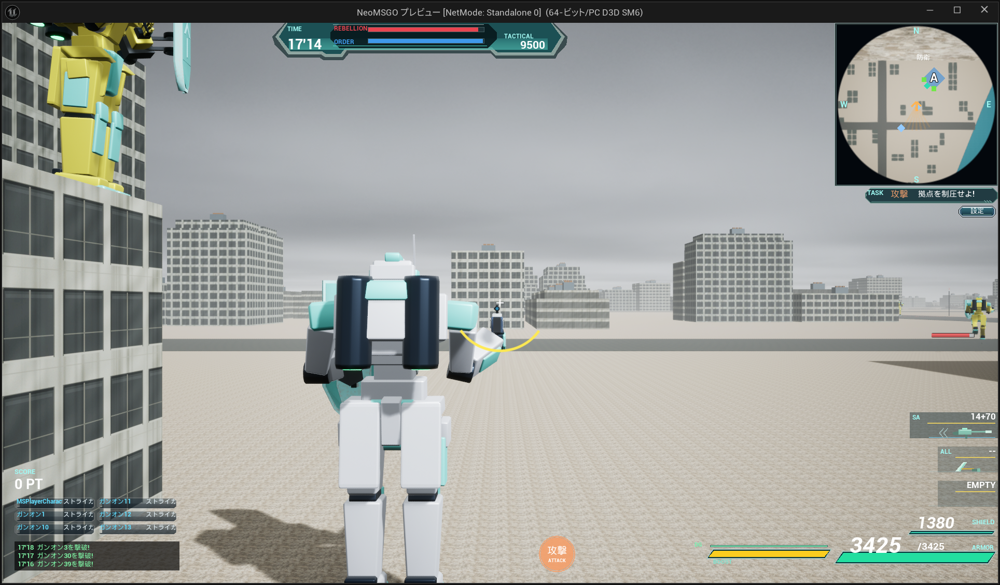

# 公開ソース版の起動・プレイ確認

確認日: 2026年9月30日〜10月1日。GitHubへ公開した `875780a` を認証なしで新しいフォルダへcloneし、取得したソースだけで新規ビルドして確認しました。元の開発プロジェクトのBinaries・保存データはコピーしていません。

## 確認できたこと

- UE 5.7.4 / Windows / MSVC 14.51 / Windows SDK 10.0.26100でEditorビルド成功。UE推奨MSVC 14.44に関する警告はあります。
- 公開マニフェストに載る2,128ファイルのハッシュ一致、リンクされた外部ファイルなし。
- Node.js 24.19.0でBackendテスト28件成功。
- UEの新規エディタウィンドウPIEで、実ゲーム描画サイズ1920×1080を確認。
- タイトルからゲストのボタン処理、OfflineLocalログイン、ロビー、ニューヤークのルーム作成、ブリーフィング、機体選択、C地点への出撃と着地が成功。
- 自機＋味方BOT24機 対 敵BOT25機。通常移動入力で約22.6m移動し、地面に接地。別の経時観測では49機中47機が1m以上移動。
- ビームライフルの通常発射処理が成功し、残弾13→12を確認。
- 緊急帰投を開始して約10.73秒の通常待ちを経て機体選択へ戻り、A地点へ再出撃・接地。
- 保存先は検証コピー内の `.local/Verify/Saved`。Backendの起動やオンラインアカウントは使っていません。

起動後の確認はEditor Pythonから通常のゲーム処理・画面ハンドラーを呼び、実PIEの値と画面で確認しています。ルーム一覧サービスは検証インスタンスだけ無効にしています。マウス・キーボードの全操作を手動で通した試験や、別PCの参加試験ではありません。

## 実画面

公開版のニューヤークへ再出撃した画面です。ゲームの表示をそのまま保存しており、ウィンドウ枠を含みます。

## まだ確認していないこと

友人PCでの初回ビルド、別PC同士のオンライン対戦、公開コピーのcook/package、全マップ・全機体・全武器の動作は未確認です。これは準備済みの公開コピーを用いたプレビューで、開発版の最新修正をすべて同期した版ではありません。第三者素材の条件の追加確認は所有者の指示で後回しにし、既存の除外・置換と帰属文書を保持しています。
